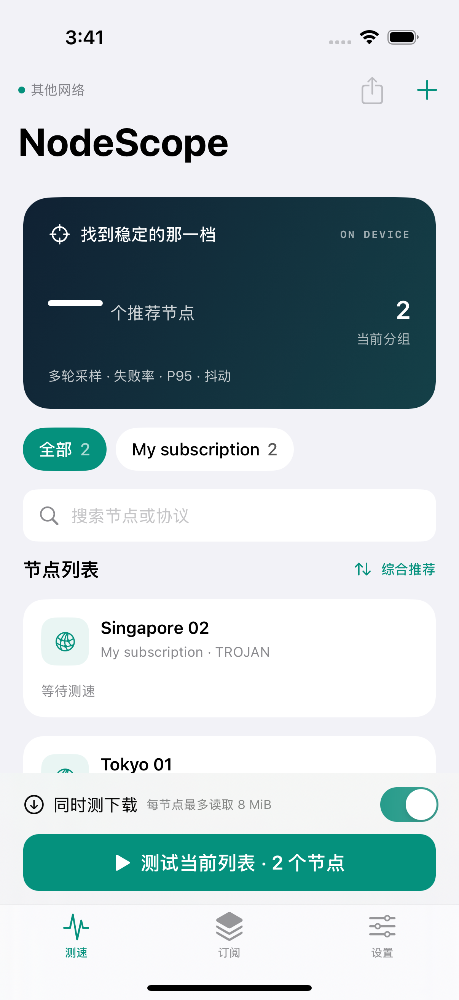

# NodeScope · iOS 节点测速

给 iPhone 用的订阅节点测速 App。按订阅分组，通过节点真实发送请求，观察延迟、失败率、抖动和可选下载速度，找出稳定、低延迟的那一档。

**iOS 16+，SwiftUI 原生界面，支持全能签 / ESign 重签名安装。** 测速核心嵌入 App，不需要 Network Extension / VPN 扩展授权。它不会为其他 App 提供代理服务。

构建包含核心测试、iOS 网络隔离与数据迁移测试，以及模拟器的订阅导入、地区排除和设置记忆测试。尚未在 iOS 27 真机验证。



## 功能

- HTTPS 订阅、Clash YAML、Base64 分享链接订阅；支持 HTTPS 远程 `proxy-providers` 与内嵌节点源，按订阅分组更新与删除。
- SS、SSR、VMess、VLESS、Trojan、Hysteria、Hysteria2、TUIC 等协议，使用固定版本 Mihomo v1.19.10。
- 8 / 16 / 32 轮延迟采样，中位数、P95、MAD 抖动、请求失败率。
- **下载测速默认关闭，开关与设置自动记忆**；默认仅 Wi-Fi，可调整读取量和时间上限。
- 综合推荐、延迟、失败率、下载速度、名称排序；支持搜索和单节点重测。
- **地区、节点与 IP 排除**：记忆地区规则和单节点、服务器 IP / 域名规则；地区根据名称匹配，不作 IP 地理查询。
- **网络档案**：分别命名移动手机、移动 Wi-Fi、电信 Wi-Fi，各自保存历史和推荐；类型自动识别，同类 Wi-Fi 需手动选档案，不依赖 SSID 权限。
- **主动暂停与继续**：保留已完成结果与队列，重启 App 后可恢复，沿用原设置；未完成节点重新采样。停止并放弃才会清掉队列。
- **下载测速 2.0**：分离建连与正文传输计时，短预热后计算均速；可选单连接 / 4 连接，多个连接共享读取上限；同时显示 Mbps 与 MB/s，过短样本不报精确速度。
- 紧凑节点列表，长按可快速排除；详情保留 P95、样本图和各网络历史。
- 最近历史、本机加密存储、CSV 导出；导出不包含订阅 URL 与节点凭据。
- 中文界面、深色模式、iPhone 与 iPad。

## 下载 IPA 并使用全能签

可在 [Releases 下载最新 IPA](https://github.com/yiyiyiyayayu/speed-text/releases/latest)，直接下载 `NodeScope-unsigned.ipa` 后按下面第 3、4 步签名安装。每次代码更新的测试构建则位于 Actions：

1. 打开 [Actions → Build iOS IPA](https://github.com/yiyiyiyayayu/speed-text/actions/workflows/build-ios.yml)。代码更新会自动构建，也可点 **Run workflow** 手动构建。
2. 打开最新一次**绿色成功**的运行，在页面下方 **Artifacts** 下载 `NodeScope-unsigned-IPA`。需要登录 GitHub；产物保留 30 天，过期可重新运行。
3. Releases 直接下载的 `.ipa` 无需解压。Actions 下载的是外层 ZIP，先解压一次得到 `NodeScope-unsigned.ipa`，再通过“文件”导入全能签；不要把外层 ZIP 改名为 IPA。
4. 在全能签中选 IPA，使用**自己的有效证书与描述文件**签名，然后安装。未签名 IPA 不能直接安装；具体能否安装取决于证书、设备授权和全能签环境。
5. 打开 App →「订阅」→ 添加订阅；「测速」页选择分组，保持下载开关关闭可先做低流量测试。

无需把 Apple 证书、密码、描述文件或真实订阅交给本仓库。仓库与 Actions 日志只包含源码和构建信息。

## 如何选出稳定的那一档

每轮使用新的 HTTP 连接，经被测节点访问 HTTPS 测试目标。不使用 ICMP Ping。节点协议自身可能复用 QUIC / 多路复用会话，符合该协议正常使用行为。

综合分关注中位延迟（50%）、P95 尾延迟（30%）、稳健抖动（20%），再用成功率三次方惩罚失败，用 Wilson 置信下界修正样本量。**下载速度不参与稳定性评分。** 排序会结合最近 24 小时相同网络档案与测试地址的历史。

推荐档位要求：结果不超过 30 分钟，至少 6 个样本，失败率 ≤10%，分数距最优不超过 8 分，并满足 P95 和抖动门槛。样本少时显示「初步推荐」；至少 3 次测试、24 个样本、记录跨度 10 分钟后显示「推荐」。详细公式见 [算法说明](docs/ALGORITHM.md)。

结果只描述测试时的观测。更换实际 Wi-Fi、其他 VPN、服务端负载、测试目标和时间段都会影响结果；App 自动识别 Wi-Fi / 蜂窝类型，具体线路使用手动网络档案区分。同类 Wi-Fi 切换时请主动选择对应档案。请在固定环境下多次比较。

## 流量与边界

- 下载默认每节点**最多读取 8 MiB 或持续 4 秒**，以先达到者为准。开启下载时，整个节点测试依次执行，避免下载占用带宽干扰其他节点延迟；仅测延迟时按设置并行。
- 读取上限不是运营商流量的硬限额：TLS、节点协议、系统预读、取消中的数据都会额外耗流量。
- 延迟探测也会耗少量流量；默认 Google 204，下载目标为 Cloudflare，均可在设置修改。
- TLS 验证默认开启。若订阅节点指定 `skip-cert-verify`，会提示该节点服务器证书验证被关闭；测试目标 HTTPS 的证书仍会验证。
- 通过订阅地址导入时，会在手机内加载 HTTPS `proxy-providers`，无需在线转换站。最多 8 个远程源、两层嵌套，全部响应合计不超过 8 MiB；拒绝循环引用和 HTTPS 降级。任一节点源失败则保持原订阅数据，避免更新成不完整列表。粘贴配置只读取内嵌节点，本机文件源不受支持；规则和脚本不会执行。
- 不支持链式 `dialer-proxy` 或依赖本机外部证书文件的配置。不保证所有协议参数组合与运营商网络均可用。
- 可开启后台续测。iOS 26+ 优先使用 `BGContinuedProcessingTask`，向系统报告进度；系统不允许时使用短时后台任务。系统结束任务后保存队列，回前台手动继续，沿用原网络档案与下载设置。每完成一个节点就保存记录和队列，系统终止 App 后仍可恢复。后台时长由 iOS 决定，无法保证全部完成；只请求立即执行，不提交稍后自动开始的队列。
- 用户主动暂停保留队列与已完成进度；停止并放弃会清除队列。网络变化时暂停，须回到原档案才能继续。被取消节点重新采样，不以半截数据评分。每节点、每网络档案保留最近 30 次记录，总上限 10,000 条。
- 测速是手动启动；不会在后台自动耗费下载流量。未完成、取消的节点不进入推荐记录。下载测速不影响稳定性评分。

## 开发与验证

本地核心测试（Linux / macOS，Go 1.24.7）：

```sh
cd core
go test -race ./...
go vet ./...
```

macOS 安装 Xcode 26 或更新版本（含 iOS 26 SDK）、Go 1.24.7、XcodeGen（`brew install xcodegen`），然后：

```sh
bash scripts/build-ipa.sh
```

产物在 `dist/NodeScope-unsigned.ipa`。脚本构建 arm64 iOS 真机静态库，再通过 XcodeGen 生成工程并构建 App；无第三方签名凭据。默认工程不含模拟器库。

核心测试包含真实本地 CONNECT 代理，验证请求经过代理、节点失败不回退直连、TLS 错误不误判成功、下载读取上限、导入去重、取消与评分惩罚。

```
core/engine/         订阅解析、节点数据路径、测速、评分与测试
core/mobile/         Swift 可调用的 C ABI
ios/NodeScope/       SwiftUI、加密存储、分组和历史
scripts/            iOS 构建、打包和开源声明
.github/workflows/  自动测试与无签名 IPA 构建
```

## 开源许可

项目使用 [GPL-3.0](LICENSE)。Mihomo v1.19.10 以 GPL-3.0 发布，其源码由 `core/go.mod`、`core/go.sum` 固定，源码地址为 [MetaCubeX/mihomo](https://github.com/MetaCubeX/mihomo/tree/v1.19.10)。各依赖许可证在构建时汇总到 App 内「开源许可」和下载附件 `THIRD_PARTY_NOTICES.txt`。

后台持续任务使用 Apple 官方 [BGContinuedProcessingTask](https://developer.apple.com/documentation/backgroundtasks/bgcontinuedprocessingtask)，仅响应用户启动，使用 CPU 与网络，不申请后台 GPU 权限。

## 下载测速口径（1.2.0）

旧版将建连、TLS 和首包等待计入下载均速；默认 URL 固定为 8 MiB，调大读取上限也不会获得更大的默认文件。新版修复这两点：默认 Cloudflare 下载请求会按所选上限生成数据，并加入防缓存标识；自定义 URL 不改写。

下载正文开始后做短预热（最多约 250 ms 或 256 KiB，以先达到者为准，按完整读取块划分；小预算预热阈值进一步降低），然后用有效正文读取位数 / 有效采样耗时计算 Mbps，采样内的停顿仍计时。详情保留建连首包耗时、预热量、有效采样量、连接数和含建连均速，便于判断差异。4 连接测多路吞吐，单连接测单路表现，需使用相同目标和连接数比较。

不足 1 秒、连接未全部参与或部分失败会标记为估计；不足 0.1 秒或有效采样过少时不生成速度数值。读取量和整个下载阶段时长以先达到者为准，预热包含在总读取量内，多连接不放大读取上限。原有下载开关、读取上限和时长保持记忆；用户可在设置主动选择较长采样（64 MiB / 8 秒 / 4 连接），最大可选 128 MiB。网络缓冲和协议开销可能增加实际流量。

8 Mbps = 1 MB/s（十进制）；MiB 仅用于读取量。此数值是节点到指定测试源的应用层观测，不是运营商物理链路速率。旧记录保留并标注旧版口径，下载排序优先新口径结果，短样本使用 ≈ 标记。
